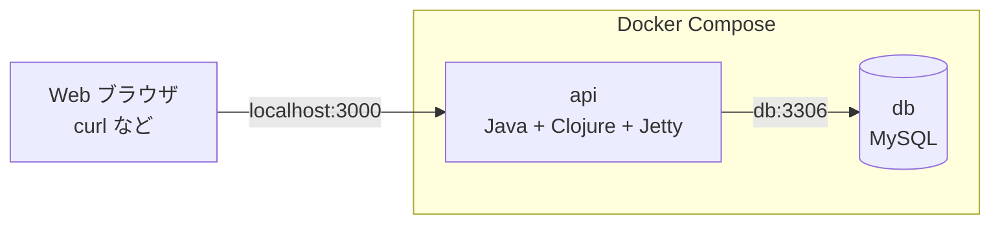
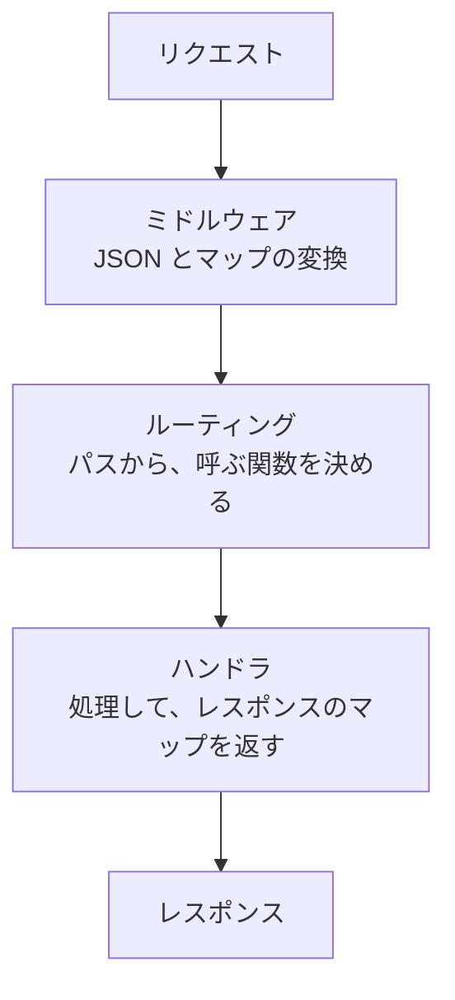

# Architecture（構成）

このリポジトリが、どういう部品でできていて、どこに何を書くのかの説明です。

- [1. コンテナの構成](#1-コンテナの構成)
- [2. リクエストの流れ](#2-リクエストの流れ)
- [3. プログラムの層](#3-プログラムの層)
- [4. ディレクトリ構成](#4-ディレクトリ構成)
- [5. テストの仕組み](#5-テストの仕組み)
- [6. 設定](#6-設定)
- [7. 注意点](#7-注意点)

---

## 1. コンテナの構成

Docker Compose で、2つのコンテナを動かします。定義は、[docker-compose.yml](../docker-compose.yml) にあります。



| コンテナ | 中身 | 手元からつなぐ先 |
| --- | --- | --- |
| `api` | Java、Clojure、Leiningen（Clojure のビルドの道具）。[Dockerfile](../Dockerfile) から作ります | `http://localhost:3000` |
| `db` | MySQL。公式のイメージを、そのまま使います | `localhost:33306` |

知っておくとよい点は、次の4つです。

- **ファイルを保存すると、変更が読み込まれます。** `api` のコンテナは、リポジトリのフォルダをそのまま読み込んでいます。`src/` の中のファイルを保存すると、次に API を呼んだときに、変わったファイルが読み込み直されます。この動きは、環境変数 `APP_ENV` が `development` のときだけ有効です。
- **ライブラリは、Docker のボリュームに入ります。** コンテナを作り直しても、ダウンロードし直さずに済むようにするためです。
- **データベースの中身は、コンテナを止めても残ります。** これも、Docker のボリュームに保存しているためです。消すときは、`make downv` を使います。
- **`api` は、`db` の準備が終わるのを待ってから起動します。** `docker-compose.yml` の `healthcheck` と `depends_on` で決めています。

---

## 2. リクエストの流れ

HTTP の処理には、Ring というライブラリを使っています。Ring では、リクエストもレスポンスも、Clojure のマップで表します。



| 部品 | 役割 | 使うライブラリ | 書く場所 |
| --- | --- | --- | --- |
| ミドルウェア | リクエストの JSON を Clojure のマップに変え、レスポンスのマップを JSON に変えます | ring-json | `src/api/core.clj` の `app` |
| ルーティング | パスとメソッドから、呼ぶ関数を決めます | Compojure | `src/api/core.clj` と、各機能の `core.clj` |
| ハンドラ | 処理を行い、レスポンスのマップを返します | Ring | 各機能の `handler.clj` |

ハンドラが返すのは、次のようなマップです。JSON への変換は、ミドルウェアが行います。

```clojure
{:status 200
 :body {:message "hello world!"}}
```

---

## 3. プログラムの層

機能ごとに、ディレクトリを分けます。1つの機能は、役割の違うファイルに分けて書きます。

| ファイル | 役割 |
| --- | --- |
| `core.clj` | その機能のルーティング。パスとメソッドを決め、ハンドラを呼びます |
| `handler.clj` | ハンドラ。リクエストから値を取り出し、処理して、レスポンスを返します。「見つからなければ 404」のような、HTTP に関わる判断は、ここに書きます |
| `repository.clj` | データベースの読み書き。SQL は、ここにだけ書きます |

```
src/api/
├── core.clj               ← 全体のルーティングと、サーバーの起動
├── db.clj                 ← データベースへの接続
├── migrate.clj            ← テーブルの作成
├── hello/
│   ├── core.clj
│   └── handler.clj
└── task/                  ← 足す機能
    ├── core.clj
    ├── handler.clj
    └── repository.clj
```

`main` ブランチには、`hello/` だけが入っています。`hello` はデータベースを使わないので、`repository.clj` はありません。3つのファイルがそろった例は、`example/task-api` ブランチにあります。

機能を足したら、`src/api/core.clj` の `app-routes` に、その機能のルーティングを追加します。

---

## 4. ディレクトリ構成

| ディレクトリ・ファイル | 内容 |
| --- | --- |
| `src/api/core.clj` | 入口です。全体のルーティング、ミドルウェアの適用、サーバーの起動を行います |
| `src/api/db.clj` | データベースへの接続です。接続先の組み立てと、SQL を実行する関数があります |
| `src/api/migrate.clj` | テーブルを作り直すスクリプトです。`make db/migrate` で実行されます |
| `src/api/<機能名>/` | 機能ごとのプログラム |
| `test/` | テスト。`src/` と同じ構成で、ファイル名の最後に `_test` を付けます |
| `project.clj` | Leiningen の設定です。依存するライブラリと、そのバージョンを書きます |
| `Dockerfile` | `api` のコンテナの作り方 |
| `docker-compose.yml` | `api` と `db` のコンテナの定義 |
| `Makefile` | よく使うコマンドをまとめたもの |
| `.github/workflows/test.yml` | 自動テストの設定 |
| `.github/dependabot.yml` | Dependabot（依存の更新の通知）の設定 |
| `readme/` | このリポジトリの文書 |

Clojure では、名前空間（`ns`）とファイルの場所が対応します。名前空間の `-` は、ファイル名では `_` になります。

| 名前空間 | ファイル |
| --- | --- |
| `api.hello.core` | `src/api/hello/core.clj` |
| `api.hello.core-test` | `test/api/hello/core_test.clj` |

---

## 5. テストの仕組み

テストは、`test/` にあります。Clojure に標準で付いている `clojure.test` を使います。

- **API を呼ぶ形で書きます。** ハンドラの関数を直接呼ばずに、テスト用のリクエスト（ring-mock）を `app` に渡して、レスポンスを確かめます。サーバーは起動しません。
- **ミドルウェアも通ります。** `app` を呼ぶので、JSON への変換も含めて確かめられます。

```clojure
(deftest test-hello
  (testing "GET /api/hello"
    (let [response (app (mock/request :get "/api/hello"))]
      (is (= 200 (:status response)))
      (is (= {:message "hello world!"} (parse-body response))))))
```

データベースを使う機能のテストの書き方は、`example/task-api` ブランチにあります。

---

## 6. 設定

環境変数で変えられます。`docker-compose.yml` の `api` の `environment` に書きます。

| 環境変数 | 既定の値 | 内容 |
| --- | --- | --- |
| `APP_ENV` | （なし） | `development` にすると、保存したファイルを読み込み直します |
| `PORT` | `3000` | API のポート番号 |
| `DB_HOST` | `db` | データベースのホスト名 |
| `DB_PORT` | `3306` | データベースのポート番号 |
| `DB_NAME` | `demo` | データベースの名前 |
| `DB_USER` | `root` | データベースのユーザー名 |
| `DB_PASSWORD` | （空） | データベースのパスワード |

読み込んでいるのは、[src/api/core.clj](../src/api/core.clj) と [src/api/db.clj](../src/api/db.clj) です。

---

## 7. 注意点

- **データベースは、パスワードなしの root でつなぐ設定です。** 手元で試すためのものです。公開する環境では、ユーザーとパスワードを設定してください。
- **`make db/migrate` は、テーブルを作り直すだけの簡単なものです。** 実行すると、データは消えます。データを残したままテーブルの形を変えたい場合は、Migratus などのマイグレーションの道具を足してください。
- **手元から MySQL につなぐときのポートは、`33306` です。** コンテナの中では `3306` です。手元の MySQL と重ならないように、ずらしています。
- **起動や、コマンドの実行に時間がかかります。** Clojure は、実行のたびに Java を起動するためです。開発中は、コンテナを起動したままにして、保存したファイルの読み込み直しを使うと、待たずに済みます。
- **公開する環境で動かす形（jar ファイルの作成など）は、用意していません。** 手元で開発するところまでが、このひな形の範囲です。
